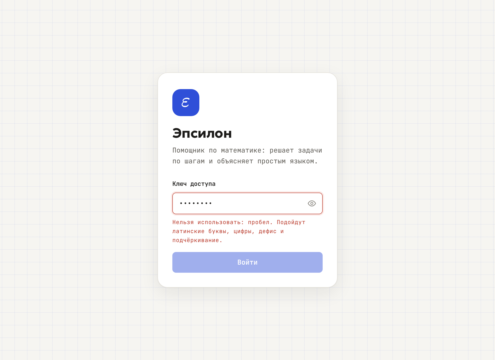
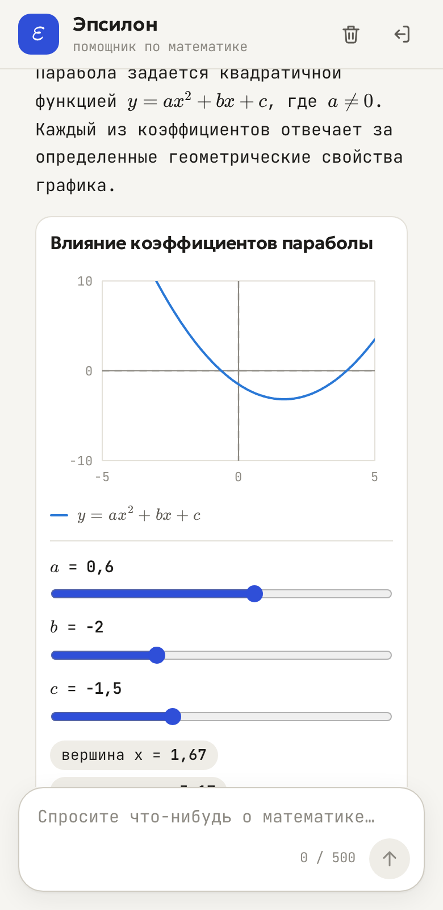

# Эпсилон — чат-помощник по математике

Одностраничное веб-приложение: вход по ключу доступа и тематический чат с языковой моделью.
Тема чата — математика. «Эпсилон» решает задачи по шагам и умеет больше, чем просто писать текст:

- **формулы** — в настоящей математической записи (LaTeX → KaTeX), а не строкой вида `x^2/(2*a)`;
- **графики и чертежи** — модель описывает, что нарисовать, а приложение рисует в едином стиле;
- **наглядные объяснения** — рисунки с ползунками: двигаешь параметр и видишь, что меняется;
- **тренажёры** — задания с проверкой ответа, подсказкой и разбором;
- ответ **печатается по мере генерации**, как в привычных чатах с нейросетью.

Стек: Python + FastAPI + SQLite · HTML + CSS + JavaScript без фреймворков и без сборки · Google Gemini API.

Демо: http://math.48-102-249-51.sslip.io (ключ доступа выдаётся отдельно).

| Вход | Наглядное объяснение | Тренажёр | На телефоне |
|---|---|---|---|
|  |  |  |  |

## Запуск

Нужен Python 3.10 или новее и ключ Gemini API ([получить бесплатно](https://aistudio.google.com/apikey), карта не нужна).

```bash
git clone <адрес репозитория> epsilon && cd epsilon
python3 -m venv .venv && source .venv/bin/activate
pip install -r requirements.txt
cp .env.example .env        # вписать ACCESS_KEY и GEMINI_API_KEY
python -m app               # http://127.0.0.1:8000
```

`ACCESS_KEY` — это ключ, который потом вводится на первом экране (8–255 символов: латинские буквы,
цифры, `-`, `_`). Значения по умолчанию у него нет: без ключа или с ключом не по правилам приложение
не запустится и объяснит, что исправить. Остальные настройки (модель, срок сессии, порт и т. д.)
перечислены в [.env.example](.env.example).

Тесты: `pip install -r requirements-dev.txt && python -m pytest` — к Gemini они не обращаются.

Что попробовать в чате: «Построй графики sin x и cos x», «Объясни наглядно, как a, b и c меняют
параболу», «Дай тренажёр на проценты».

## Что умеет

| Требование ТЗ | Как сделано |
|---|---|
| Поле ключа: 8–255 символов, латиница, цифры, `-`, `_` | Проверка на лету с подсказкой, чего не хватает («ещё 3 символа», «нельзя использовать: пробел»). Те же правила повторно проверяет сервер |
| Кнопка входа заблокирована при невалидном поле | Да; при отправке на кнопке индикатор, повторный клик невозможен |
| Сообщение об ошибке при неверном ключе | «Неверный ключ доступа» под полем; после 5 неудач с одного адреса — пауза на 5 минут |
| Сообщение 1–500 символов, пустое не отправляется | Счётчик `0 / 500`; при превышении он краснеет, кнопка блокируется (текст не обрезается молча) |
| Кнопка отправки заблокирована, пока ждём ответ | Да — до конца генерации; до первых слов ответа в ленте индикатор «Решаю…» |
| Ошибка запроса к API | Неотправленный вопрос остаётся в ленте с причиной и кнопками «Повторить» / «Убрать» |
| Контекст модели (необязательно) | Модель помнит 5 последних пар «вопрос — ответ» (`CONTEXT_EXCHANGES`) |
| Один чат, формат диалога, дата и время у каждой записи | Да; время показывается в часовом поясе пользователя |
| История переживает перезагрузку страницы и перезапуск | SQLite-файл `data/chat.sqlite3`; графики и тренажёры восстанавливаются из истории вместе с текстом |

Сверх ТЗ: формулы, графики, интерактивные объяснения и тренажёры, потоковый вывод ответа, светлая и
тёмная тема, вёрстка под телефон, примеры вопросов в пустом чате, очистка истории, выход, запасные
модели и автоповтор на случай сбоев Gemini.

## Авторизация

Ключ доступа — общий секрет, поэтому главная идея: **ключ живёт в браузере ровно один запрос**,
дальше работает отдельная сессия.

1. Форма отправляет ключ один раз: `POST /api/auth/login`, в теле JSON. Он не попадает в адресную
   строку, не сохраняется в `localStorage` и не остаётся в переменных скрипта — поле очищается сразу
   после успешного входа.
2. Сервер проверяет формат и сравнивает ключ с `ACCESS_KEY` за постоянное время
   (`hmac.compare_digest`), чтобы по времени ответа нельзя было подбирать его посимвольно.
3. При успехе сервер создаёт случайный токен сессии (256 бит) и отдаёт его в cookie с флагами
   `HttpOnly` (скрипты страницы не могут его прочитать — XSS не украдёт сессию),
   `SameSite=Strict` (чужой сайт не сможет отправить запрос от имени пользователя — защита от CSRF)
   и `Secure`, если сайт открыт по HTTPS.
4. В базе хранится только SHA-256 от токена: утечка файла базы не даёт готовых сессий.
   Сессия живёт 7 дней (`SESSION_TTL_HOURS`), «Выйти» удаляет её на сервере — старый токен
   перестаёт работать сразу.
5. Все `/api/messages` закрыты одной зависимостью `require_session`; без действующей сессии — `401`.
   Если сессия истекла посреди работы, интерфейс возвращает на экран входа с пояснением.
6. Перебор ключа ограничен: 5 неудачных попыток с одного адреса за 5 минут, затем `429`.

Почему не «хранить ключ на фронте и слать в заголовке с каждым запросом»: тогда ключ пришлось бы
держать в `localStorage`, где его достанет любой внедрённый скрипт, а отозвать доступ можно было бы
только сменой ключа для всех. С сессией ключ можно сменить, а выданные сессии — отозвать по одной.

Дополнительно сервер выставляет строгую Content-Security-Policy (скрипты, стили и шрифты — только
со своего адреса; KaTeX и шрифты лежат в репозитории, а не грузятся с CDN), а всё, что пишет
модель, попадает на страницу только как текст или как данные (см. ниже) — ни HTML, ни код из
ответа не исполняются.

## Графики, наглядные объяснения и тренажёры

Модель не присылает ни картинок, ни HTML, ни JavaScript. Когда рисунок или практика уместны, она
вставляет в ответ **блок с описанием в JSON**, а рисует его приложение:

````
```plot
{"title": "Касательная к параболе", "x": [-3, 3], "y": [-2, 9],
 "params": [{"name": "p", "min": -2.5, "max": 2.5, "value": 1, "step": 0.1}],
 "functions": [{"expr": "x^2", "label": "$y = x^2$"},
               {"expr": "2*p*(x - p) + p^2", "label": "касательная"}],
 "points": [{"x": "p", "y": "p^2", "label": "точка касания"}],
 "readouts": [{"label": "наклон $2p$", "expr": "2*p"}]}
```
````

- **`plot`** — графики функций, параметрические кривые, точки, отрезки, многоугольники, окружности,
  асимптоты, заливка под кривой. С полем `params` появляются ползунки, с `readouts` — значения,
  которые пересчитываются на лету: так получаются наглядные объяснения («двигай и смотри»).
- **`trainer`** — 3–5 заданий: ввод числа (принимаются `0,5`, `1/2`, `sqrt(2)`, несколько корней
  через `;`) или выбор варианта, подсказка, решение, итог. К заданию можно приложить рисунок.

Что это даёт:

- **Один стиль.** Линии, цвета, шрифты, подписи и поведение заданы в коде приложения
  (`static/js/widgets/`, `static/css/widgets.css`), а не моделью: все рисунки выглядят одинаково,
  подстраиваются под тёмную тему и ширину экрана. Палитра графиков проверена на различимость,
  в том числе при нарушениях цветового зрения; под курсором — значения функций в точке.
- **Безопасность.** Исполнять присланный моделью код не нужно вообще. Выражения вроде
  `a*x^2 + sin(x)` вычисляет собственный небольшой разбор (`widgets/expr.js`) — без `eval`,
  который к тому же запрещён Content-Security-Policy.
- **Устойчивость.** Испорченный блок не ломает ответ: вместо него показывается аккуратная заглушка
  с причиной. Типичную ошибку моделей — неудвоенную `\` в JSON (`"\frac"`) — приложение чинит само.
- **История.** Блок — часть текста сообщения, поэтому после перезагрузки рисунки и тренажёры
  восстанавливаются без отдельного хранения.

Когда рисовать, а когда нет, и точный формат блоков описаны в системном промпте
(`app/chat/prompt.py`).

## Устройство проекта

```
app/                        бэкенд
├── __main__.py             запуск: python -m app
├── main.py                 сборка приложения: настройки → база → сервисы → маршруты
├── config.py               настройки из окружения и .env, правила для ключа и сообщения
├── db.py                   SQLite: подключение и схема (messages, sessions)
├── errors.py               ошибки и их единый JSON-формат {"error": {"code", "message"}}
├── clock.py                время: UTC, ISO 8601
├── auth/
│   ├── router.py           POST /login, GET /session, POST /logout
│   ├── service.py          проверка ключа, выдача и отзыв сессий
│   ├── sessions.py         хранилище сессий
│   ├── rate_limit.py       ограничение попыток входа
│   ├── dependencies.py     require_session — охрана закрытых маршрутов
│   └── schemas.py          проверка формата ключа
├── chat/
│   ├── router.py           GET / POST / DELETE /api/messages; ответ модели — потоком событий
│   ├── service.py          сценарий «вопрос → ответ по частям → запись пары в историю»
│   ├── messages.py         хранилище сообщений
│   ├── prompt.py           системный промпт: тема, формат ответа, блоки plot и trainer
│   └── schemas.py          проверка сообщения, формат ответов
└── llm/
    ├── base.py             контракт модели (LLMClient) и типы ошибок
    └── gemini.py           клиент Gemini API: потоковый ответ, запасные модели
static/                     фронтенд, отдаётся как есть
├── index.html              оба экрана: вход и чат
├── css/                    tokens (цвета, шрифты, палитра графиков) · base · login · chat ·
│                           prose (текст ответа) · widgets (графики и тренажёры)
├── js/
│   ├── main.js             выбор экрана
│   ├── api.js              все запросы к серверу, чтение потока ответа, единый тип ошибки
│   ├── validation.js       правила полей ввода
│   ├── views/              login.js — экран входа · chat.js — экран чата и «печать» ответа
│   ├── render/             markdown.js (разметка → DOM) · math.js (KaTeX) ·
│   │                       streaming.js (что показывать, пока ответ не дописан) · datetime.js
│   └── widgets/            index.js (реестр блоков) · plot.js (график) · trainer.js (тренажёр) ·
│                           expr.js (вычисление выражений) · format.js (числа и отметки осей)
└── vendor/                 katex/ — KaTeX 0.19.1 (MIT) · fonts/ — JetBrains Mono и Geologica (OFL)
tests/                      pytest: авторизация, чат и поток событий, клиент Gemini
```

### Решения и их причины

- **Слои внутри каждой области.** Маршрут разбирает HTTP, сервис описывает сценарий, хранилище знает
  про SQL. Сервис чата зависит от контракта `LLMClient`, а не от Gemini: модель меняется одним
  классом, а в тестах подставляется заглушка — тесты быстрые и не тратят квоту.
- **SQLite.** Один чат и один процесс — отдельный сервер БД был бы лишним. Это один файл, ноль
  настройки, при этом настоящие транзакции.
- **Потоковый ответ.** `POST /api/messages` отвечает потоком Server-Sent Events: `delta` (часть
  текста), `done` (пара сохранена), `error`, `reset`. Первую часть сервер ждёт до отправки
  заголовков, поэтому «модель не ответила вовсе» остаётся обычной ошибкой с HTTP-статусом.
  На экране текст допечатывается плавно, хотя от модели приходит неровными порциями.
- **Недописанное не мигает.** Пока ответ печатается, незакрытая формула не показывается сырым
  LaTeX — она появляется целиком, когда дописана; недописанный блок графика заменяется заглушкой
  «Рисую график…». Готовые формулы и рисунки между перерисовками берутся из памяти.
- **В историю попадают только завершённые пары.** Вопрос и ответ пишутся одной транзакцией после
  конца генерации. Если модель не ответила или ответ оборвался, в базе ничего не меняется: не
  бывает «висящих» вопросов и обрывков, а контекст для модели всегда корректно чередует роли.
- **Сбои Gemini.** Бесплатный Gemini нередко отвечает `503`, надолго задумывается или обрывает
  ответ на полуслове. Клиент ждёт очередную часть не дольше 20 секунд и по очереди пробует
  `GEMINI_MODEL` и `GEMINI_FALLBACK_MODELS`; оборванный ответ один раз запрашивается заново
  (текст на экране сбрасывается). Пользователь видит короткое понятное сообщение, подробности
  остаются в логах сервера.
- **Свой разбор Markdown (~250 строк) вместо библиотеки.** Нужен небольшой набор разметки, зато
  с особыми правилами для формул и блоков; страница собирается через DOM API, строки ответа нигде
  не превращаются в HTML, поэтому отдельная «очистка» не нужна.
- **Шрифты.** Текст — моноширинный JetBrains Mono: цифры и знаки стоят ровно, как в тетради
  в клетку. Заголовки — Geologica: тот же геометрический характер, но пропорциональный и плотный,
  поэтому заголовок сразу отличим от текста. Оба шрифта лежат в репозитории.
- **Без сборки.** Нативные ES-модули: репозиторий запускается сразу после `pip install`, Node.js
  не нужен.
- **Правила полей в двух местах.** Фронтенд проверяет ради удобства, сервер — ради безопасности;
  серверные правила лежат в `app/config.py`, клиентские — в `static/js/validation.js`.

### API

| Метод и путь | Назначение |
|---|---|
| `POST /api/auth/login` `{access_key}` | Вход: `204` и cookie сессии · `401` неверный ключ · `422` формат · `429` слишком много попыток |
| `GET /api/auth/session` | `{authenticated: true/false}` — какой экран показать |
| `POST /api/auth/logout` | Отозвать сессию |
| `GET /api/messages` | История: `{messages: [{id, role, text, created_at}]}` |
| `POST /api/messages` `{text}` | Вопрос → `201` и поток событий `delta` / `reset` / `done {user, assistant}` / `error` · `422` пустой или длиннее 500 · `502/503/504` модель не ответила |
| `DELETE /api/messages` | Очистить историю |

## Что можно доработать

- **Дописывать ответ, если страницу закрыли посреди генерации.** Сейчас в этом случае пара не
  сохраняется; правильнее продолжать генерацию на сервере и показывать ответ при следующем входе.
- **Автотесты фронтенда в репозитории.** Разбор выражений, разметки и блоков проверялся в браузере
  (Playwright), но в репозитории лежат только тесты бэкенда; нужны юнит-тесты JS и CI.
- **Больше видов блоков:** таблицы значений, числовая прямая, диаграммы для статистики, пошаговые
  объяснения «шаг вперёд — шаг назад», задания с перетаскиванием.
- **Проверка ответов-выражений** в тренажёре (`2x + 1`, промежутки, дроби как текст), а не только чисел.
- **Предпросмотр формул при вводе** и кнопки частых символов (√, ∫, дробь), ввод задачи с фотографии.
- **Сохранять неотправленный вопрос и прогресс тренажёра** — сейчас они живут до перезагрузки страницы.
- **Постраничная загрузка истории** и ограничение частоты сообщений на сервере.
- **Счётчик попыток входа и сессии во внешнем хранилище** (Redis), если экземпляров приложения станет
  несколько: сейчас счётчик живёт в памяти процесса.
- **Несколько чатов и пользователей** — понадобится таблица чатов и привязка сессии к пользователю.
- **Docker-образ** для запуска одной командой; копирование ответа и формул, экспорт решения в PDF.
