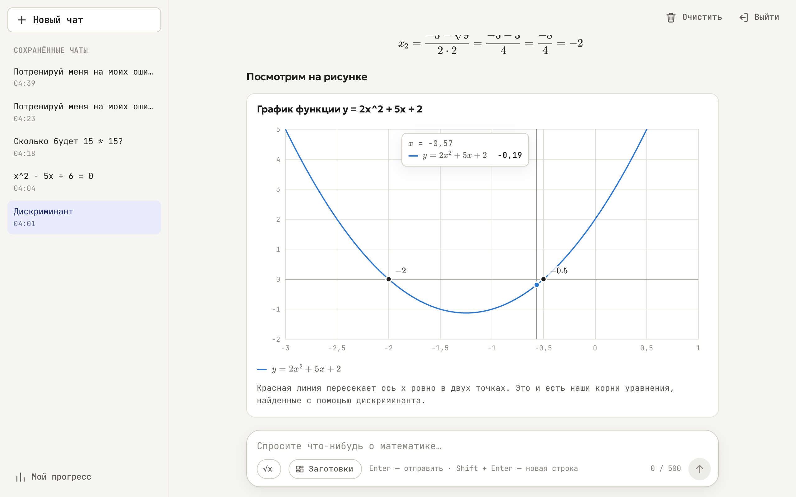
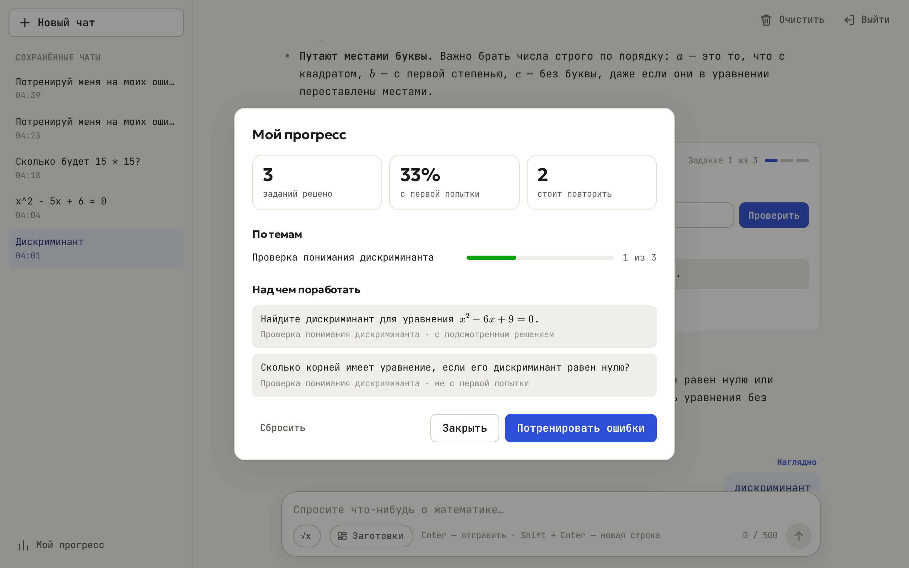

# Эпсилон — чат-помощник по математике

[](https://github.com/zahar-pr/testtask_chat/actions/workflows/ci.yml)

Тестовое задание: одностраничное веб-приложение — вход по ключу доступа и тематический чат с языковой
моделью. Тема чата — математика: «Эпсилон» объясняет темы с нуля, решает задачи по шагам, рисует
графики и даёт потренироваться.


- **Бэкенд:** Python, FastAPI, SQLite
- **Фронтенд:** HTML + CSS + JavaScript без фреймворков и без сборки
- **Модель:** Google Gemini API

Демо: http://math.48-102-249-51.sslip.io — ключ доступа не публикуется, пришлю по запросу.

## Содержание

1. [Запуск](#запуск)
2. [Что сделано по ТЗ](#что-сделано-по-тз)
3. [Авторизация](#авторизация)
4. [Устройство проекта](#устройство-проекта)
5. [Сверх ТЗ](#сверх-тз)
6. [Проверки](#проверки)
7. [Что можно доработать](#что-можно-доработать)

## Запуск

Нужен Python 3.10+ и ключ Gemini API ([получить бесплатно](https://aistudio.google.com/apikey), карта не нужна).

```bash
git clone https://github.com/zahar-pr/testtask_chat.git && cd testtask_chat
python3 -m venv .venv && source .venv/bin/activate
pip install -r requirements.txt
cp .env.example .env        # вписать ACCESS_KEY и GEMINI_API_KEY
python -m app               # открыть http://127.0.0.1:8000
```

Или в Docker, после того же `.env`: `docker compose up --build`.

`ACCESS_KEY` — ключ, который вводится на первом экране: 8–255 символов, латинские буквы, цифры, `-`, `_`.
Значения по умолчанию у него нет: без ключа или с ключом не по правилам приложение не запустится
и объяснит, что исправить. Остальные настройки (модель, срок сессии, порт) — в [.env.example](.env.example).

## Что сделано по ТЗ

| Требование | Как сделано |
|---|---|
| Первый экран — одно поле для ключа доступа | Да. Ключ проверяет сервер, сам ключ задаётся переменной окружения `ACCESS_KEY` |
| Ключ: 8–255 символов, латиница, цифры, `-`, `_` | Проверка на лету с подсказкой, чего не хватает («ещё 3 символа», «нельзя использовать: пробел»); те же правила повторно проверяет сервер |
| Кнопка входа заблокирована, пока поле невалидно | Да; во время проверки на кнопке индикатор, повторный клик невозможен |
| Сообщение об ошибке при неверном ключе | «Неверный ключ доступа» под полем; после 5 неудач с одного адреса — пауза на 5 минут |
| Чат в рамках темы, заданной системным промптом | Математика; на посторонние просьбы модель вежливо отказывает (`app/chat/prompt.py`) |
| Сообщение: 1–500 символов | Счётчик `0 / 500`; при превышении краснеет, кнопка блокируется — текст не обрезается молча |
| Пустое или из пробелов — не отправляется | Да, и на клиенте, и на сервере |
| Кнопка отправки заблокирована, пока ждём ответ | Да — до конца ответа; рядом появляется отдельная кнопка «Остановить» |
| При ошибке запроса к API — сообщение об ошибке | Вопрос остаётся в ленте с причиной и кнопками «Повторить», «Изменить», «Убрать» |
| Контекст модели (необязательно) | Сделан: модель помнит 5 последних пар «вопрос — ответ» этого чата |
| Сообщения в формате диалога | Да. В ТЗ чат один — здесь их можно завести несколько, каждый сохраняется отдельно |
| У каждой записи — дата и время, текст | Да, время показано в часовом поясе пользователя |
| История переживает перезагрузку и перезапуск | SQLite-файл; после перезагрузки открывается тот же чат |
| README: запуск, устройство, что доработать | Этот файл |

## Авторизация

Ключ доступа — общий секрет, поэтому главная идея: **ключ находится в браузере ровно один запрос**,
дальше работает отдельная сессия.

```
браузер                                   сервер
   │  POST /api/auth/login {access_key}     │  проверка формата → сравнение с ACCESS_KEY
   │ ─────────────────────────────────────▶ │  → новый случайный токен сессии
   │  204 + Set-Cookie: epsilon_session=…   │  → в базу ложится только SHA-256 токена
   │ ◀───────────────────────────────────── │
   │  дальше: любые запросы с cookie        │  require_session: токен → хеш → есть в базе, не истёк?
```

1. **Передача.** Форма отправляет ключ один раз, в теле POST-запроса. Он не попадает в адресную
   строку, не сохраняется в `localStorage` и не остаётся в переменных скрипта: поле очищается сразу
   после входа.
2. **Проверка.** Сервер проверяет формат и сравнивает SHA-256 от присланного ключа с SHA-256 от
   `ACCESS_KEY` за постоянное время (`hmac.compare_digest`): по времени ответа нельзя ни подобрать
   ключ посимвольно, ни узнать его длину.
3. **Сессия вместо ключа.** При успехе сервер создаёт случайный токен (256 бит) и отдаёт его в cookie:
   - `HttpOnly` — скрипты страницы не могут её прочитать, XSS не украдёт сессию;
   - `SameSite=Strict` — чужой сайт не отправит запрос от имени пользователя (защита от CSRF);
   - `Secure` — если сайт открыт по HTTPS.
4. **Хранение.** В базе лежит только SHA-256 от токена: утечка файла базы не даёт готовых сессий.
   Сессия живёт 7 дней (`SESSION_TTL_HOURS`); «Выйти» удаляет её на сервере — токен перестаёт
   работать сразу. Сам `ACCESS_KEY` живёт только в окружении сервера и нигде не сохраняется.
5. **Доступ.** Все `/api/chats…` и `/api/progress…` закрыты одной зависимостью `require_session`:
   без действующей сессии — `401`. Если сессия истекла посреди работы, интерфейс возвращает на экран
   входа с пояснением.
6. **Перебор.** 5 неудачных попыток с одного адреса за 5 минут — затем `429` с `Retry-After`.
7. **Дополнительно.** Изменяющие запросы с чужим заголовком `Origin` отклоняются (второй рубеж
   против CSRF). Строгая Content-Security-Policy: скрипты, стили и шрифты — только со своего адреса
   (KaTeX и шрифты лежат в репозитории). Текст модели вставляется в страницу только как текст или
   данные — ни HTML, ни код из ответа не исполняются.

Почему не «хранить ключ на фронте и слать в заголовке с каждым запросом»: ключ пришлось бы держать
в `localStorage`, где его достанет любой внедрённый скрипт, а отозвать доступ можно было бы только
сменой ключа для всех. С сессией ключ можно сменить, а выданные сессии — отозвать по одной.

Код: `app/auth/` (маршруты, сервис, хранилище сессий, ограничитель попыток), `app/security.py`,
на клиенте — `static/js/views/login.js` и `static/js/api.js`. Тесты: `tests/test_auth.py`,
`tests/e2e/test_login.py`.

## Устройство проекта

```
app/                    бэкенд
├── main.py             сборка приложения: настройки → база → сервисы → маршруты
├── config.py           настройки из окружения и .env, правила для ключа и сообщения
├── db.py               SQLite: подключение, схема и её обновление
├── errors.py           ошибки и их единый формат {"error": {"code", "message"}}
├── security.py         заголовки безопасности, отказ запросам с чужого сайта
├── auth/               вход: router (HTTP) · service (ключ, сессии) · sessions (хранилище) ·
│                       rate_limit (перебор) · dependencies (require_session) · schemas
├── chat/               чат: router · service (сценарий «вопрос → ответ → запись») ·
│                       repository (чаты и сообщения) · prompt (системный промпт) ·
│                       modes (заготовки) · titles · schemas
├── progress/           результаты тренажёров: router · repository · schemas
└── llm/                модель: base (контракт LLMClient, ошибки) · gemini (клиент Gemini)

static/                 фронтенд, отдаётся как есть — сборки нет
├── index.html          оба экрана: вход и чат
├── css/                tokens (цвета, шрифты) · base · login · chat · prose · widgets · progress
└── js/
    ├── main.js         выбор экрана: вход или чат
    ├── api.js          все запросы к серверу, чтение потока ответа, единый тип ошибки
    ├── validation.js   правила полей ввода
    ├── modes.js        заготовки: названия, примеры, продолжения разговора
    ├── views/          экраны и их части: login · chat (связывает остальные) · sidebar ·
    │                   messages · composer · welcome · progress · confirm
    ├── render/         текст ответа → страница: markdown · math (KaTeX) · mathtext ·
    │                   streaming · datetime
    └── widgets/        графики и тренажёры: plot · trainer · expr (разбор выражений) · format

evals/                  автопроверка качества ответов модели
tests/                  pytest: бэкенд · tests/e2e — сценарии в браузере · tests/js — модули JS
```

### Как проходит один вопрос

1. `composer.js` проверяет текст и передаёт его в `chat.js`, тот вызывает `api.sendMessage`.
2. `chat/router.py` проверяет сессию и формат, `chat/service.py` собирает контекст чата и просит
   ответ у `LLMClient`.
3. `llm/gemini.py` получает ответ от Gemini по частям; сервер пересылает их браузеру потоком событий.
4. `messages.js` допечатывает текст, `render/` превращает разметку и формулы в элементы страницы.
5. Когда ответ получен целиком, `chat/repository.py` одной транзакцией сохраняет вопрос и ответ.

### Почему так

- **Слои внутри каждой области.** Маршрут разбирает HTTP, сервис описывает сценарий, хранилище знает
  про SQL. Сервис чата зависит от контракта `LLMClient`, а не от Gemini: модель меняется одним
  классом, а в тестах подставляется заглушка — тесты быстрые и не тратят квоту.
- **SQLite.** Один процесс и небольшой объём данных — отдельный сервер БД был бы лишним. Это один
  файл без настройки, при этом настоящие транзакции. Схема обновляется сама при запуске.
- **В историю попадают только завершённые пары.** Вопрос и ответ пишутся одной транзакцией после
  конца ответа. Если модель не ответила, в базе ничего не меняется: нет «висящих» вопросов и
  обрывков, а контекст для модели всегда корректно чередует роли.
- **Ответ потоком.** Текст приходит по мере генерации (Server-Sent Events) и плавно допечатывается.
  Ошибка до первой части остаётся обычной ошибкой с HTTP-статусом.
- **Сбои модели — часть нормы.** Бесплатный Gemini отвечает `503`, задумывается и обрывает ответы.
  Клиент пробует запасные модели, оборванный ответ один раз запрашивается заново; пользователь
  видит короткое понятное сообщение, подробности остаются в логах.
- **Модель присылает данные, а не разметку.** График или тренажёр — это JSON-описание, которое
  рисует приложение: единый стиль, тёмная тема и никакого исполнения чужого кода.
- **Без фреймворков и без сборки.** Нативные ES-модули: каждый файл отвечает за одно, приложение
  запускается сразу после `pip install`. Сторонний код на фронтенде — только KaTeX (формулы).
- **Правила полей — в двух местах.** Фронтенд проверяет ради удобства, сервер — ради безопасности
  (`app/config.py` и `static/js/validation.js`).

## Сверх ТЗ

| | |
|---|---|
|  |  |
| **Заготовки** — шесть режимов: изучить тему с нуля, решить задачу, потренироваться, показать наглядно, проверить своё решение, собрать шпаргалку | **Графики и наглядные объяснения** — рисунки в едином стиле, с ползунками и значениями под курсором |
|  |  |
| **Тренажёры** — задания с проверкой ответа, подсказкой и решением | **Прогресс** — результаты тренажёров и тренировка по своим ошибкам |

Ещё: формулы в настоящей записи (KaTeX) и их предпросмотр при вводе, несколько сохранённых чатов,
остановка ответа, «ответить заново», правка последнего вопроса, продолжение разговора одной кнопкой,
светлая и тёмная тема, вёрстка под телефон.

Как это устроено — в [docs/features.md](docs/features.md); там же описание API.

## Проверки

```bash
pip install -r requirements-dev.txt
python -m pytest --ignore=tests/e2e   # бэкенд: 59 тестов, к Gemini не обращаются
ruff check .                          # линтер
npm test                              # модули JS: 25 тестов (нужен Node.js 22+, только для тестов)

pip install -r requirements-e2e.txt && playwright install chromium
python -m pytest tests/e2e            # 15 сценариев в настоящем браузере, модель подставная

python -m evals                       # качество ответов настоящей модели
```

Всё, кроме последнего, запускается в GitHub Actions при каждом изменении; там же собирается
и стартует Docker-образ.

`python -m evals` задаёт модели 20 контрольных вопросов и проверяет ответы кодом: есть ли в уроке
все разделы, исправны ли графики и тренажёры, верны ли числа, отказывает ли модель на постороннее.
Последний прогон — [evals/report.md](evals/report.md). Так видно, стало ли после правки промпта
лучше или хуже, — без чтения ответов глазами.

## Что можно доработать

- **Проверка вычислений инструментом.** Модель иногда ошибается в арифметике; надёжнее дать ей
  вызывать калькулятор на сервере и помечать ответ «проверено вычислением».
- **Пользователи.** Сейчас чаты и прогресс общие для всех, кто знает ключ доступа. Для личных
  данных нужна привязка сессии к пользователю; тогда же — счётчик попыток входа в общем хранилище
  (Redis), если экземпляров приложения станет несколько.
- **Дописывать ответ, если страницу закрыли посреди генерации.** Сейчас в этом случае пара не
  сохраняется; правильнее продолжать генерацию на сервере.
- **Урок порциями.** Урок «с нуля» приходит целиком; лучше вести его шагами — объяснил, спросил,
  дождался ответа, пошёл дальше.
- **Правка любых сообщений**, а не только последней пары; сохранение состояния тренажёра после
  перезагрузки страницы.
- **Управление чатами:** переименование, поиск, постраничная загрузка длинной истории,
  ограничение частоты сообщений на сервере.
- **Автопроверка шире:** больше контрольных вопросов, оценка объяснений второй моделью, запуск по
  расписанию с графиком качества по версиям промпта.
- **Новые возможности:** задача по фотографии, оценки ответов 👍/👎, таблицы и диаграммы в ответах.
