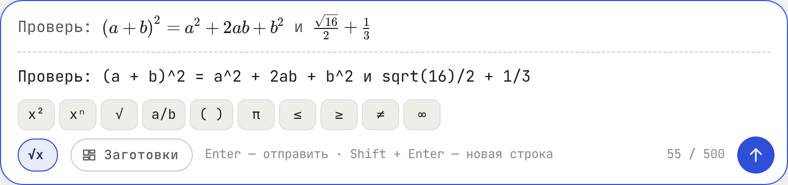

# Возможности подробно

Этот файл дополняет [README](../README.md): здесь описано, как устроены возможности, которых нет в ТЗ.

## Чаты

- Слева — список сохранённых чатов (на телефоне он открывается кнопкой в шапке), сверху — только
  «Очистить» и «Выйти». Чат, в котором писали последним, стоит первым; название — начало первого вопроса.
- Чат сохраняется сам: он создаётся в базе вместе с первой парой «вопрос — ответ», одной
  транзакцией. Пустых чатов не бывает, отдельной кнопки «сохранить» нет.
- Открытый чат записан в адресе страницы (`#12`, `#new`), поэтому переживает перезагрузку, а кнопка
  «Назад» возвращает к предыдущему чату. Без номера в адресе открывается последний чат.
- Контекст для модели берётся только из того же чата. «Очистить» удаляет открытый чат целиком,
  остальные остаются. Пока модель отвечает, переключение чатов заблокировано.
- База от прежней версии (с единственным чатом) при запуске дополняется сама: старая переписка
  становится первым сохранённым чатом.
- **Остановить, ответить заново, изменить.** «Остановить» прерывает генерацию — ответ не
  сохраняется, вопрос остаётся на экране. «Ответить заново» и «Изменить» доступны для последней
  пары чата: новый вопрос уходит с флагом `replace_last`, и сервер заменяет старую пару новой
  одной транзакцией — если модель не ответила, прежняя пара остаётся на месте.
- **Продолжения.** Под последним ответом — кнопки следующего шага; набор зависит от заготовки
  (после урока — «Объясни проще», «Ещё пример», «Потренироваться», «Что дальше?»).


## Заготовки

Один и тот же вопрос «про дискриминант» может значить разное: объяснить с нуля, решить пример, дать
задачи. Если отвечать на всё одинаково, выходит плохо — например, новичку достаётся сухая формула.
Поэтому у чата есть **заготовки** — шесть режимов со своими правилами ответа:

| Заготовка | Что получится |
|---|---|
| Изучить тему с нуля | Урок для новичка: зачем это нужно → что знать заранее → главная идея → пример → рисунок → частые ошибки → тренажёр → что дальше. Ни одного термина без объяснения |
| Решить задачу | Решение по шагам и ответ |
| Потренироваться | Тренажёр из 4–5 заданий от простого к сложному |
| Показать наглядно | Рисунок с ползунками и короткий вывод |
| Проверить моё решение | Вердикт, первая ошибка, почему это ошибка и как исправить |
| Собрать шпаргалку | Определения и формулы темы на одном экране |

Как это устроено:

- В пустом чате заготовки показаны карточками; у поля ввода есть кнопка «Заготовки» — режим можно
  выбрать и посреди разговора. Пользователь пишет только тему или условие (или жмёт на пример).
- Запрос уходит как `{text, mode}`. В истории хранится собственный текст пользователя и название
  режима (оно показано над сообщением), а модель получает запрос в виде
  «Режим «Изучение с нуля». Тема: дискриминант» — так она видит режимы и прошлых вопросов.
- Что делать в каждом режиме, описано в системном промпте (`app/chat/prompt.py`). Там же сказано,
  как распознать режим по смыслу, если заготовка не выбрана: «изучим с нуля, что такое…» и без
  кнопки даст урок, а не решение.
- Заготовка действует на одно сообщение; уточнения («не понял», «ещё пример») продолжают в том же
  стиле благодаря контексту.
- Новая заготовка — это запись в `app/chat/modes.py` (как формулировать запрос), раздел в промпте
  и запись в `static/js/modes.js` (название, описание, примеры).


## Графики, наглядные объяснения и тренажёры

Модель не присылает ни картинок, ни HTML, ни JavaScript. Когда рисунок или практика уместны, она
вставляет в ответ **блок с описанием в JSON**, а рисует его приложение:

````
```plot
{"title": "Касательная к параболе", "x": [-3, 3], "y": [-2, 9],
 "params": [{"name": "p", "min": -2.5, "max": 2.5, "value": 1, "step": 0.1}],
 "functions": [{"expr": "x^2", "label": "$y = x^2$"},
               {"expr": "2*p*(x - p) + p^2", "label": "касательная"}],
 "points": [{"x": "p", "y": "p^2", "label": "точка касания"}],
 "readouts": [{"label": "наклон $2p$", "expr": "2*p"}]}
```
````

- **`plot`** — графики функций, параметрические кривые, точки, отрезки, многоугольники, окружности,
  асимптоты, заливка под кривой. С полем `params` появляются ползунки, с `readouts` — значения,
  которые пересчитываются на лету: так получаются наглядные объяснения («двигай и смотри»).
- **`trainer`** — 3–5 заданий: ввод числа (принимаются `0,5`, `1/2`, `sqrt(2)`, несколько корней
  через `;`) или выбор варианта, подсказка, решение, итог. К заданию можно приложить рисунок.

Что это даёт:

- **Один стиль.** Линии, цвета, шрифты, подписи и поведение заданы в коде приложения
  (`static/js/widgets/`, `static/css/widgets.css`), а не моделью: все рисунки выглядят одинаково,
  подстраиваются под тёмную тему и ширину экрана. Палитра графиков проверена на различимость,
  в том числе при нарушениях цветового зрения; под курсором — значения функций в точке.
- **Безопасность.** Исполнять присланный моделью код не нужно вообще. Выражения вроде
  `a*x^2 + sin(x)` вычисляет собственный небольшой разбор (`widgets/expr.js`) — без `eval`,
  который к тому же запрещён Content-Security-Policy.
- **Устойчивость.** Испорченный блок не ломает ответ: вместо него показывается аккуратная заглушка
  с причиной. Типичные ошибки моделей приложение чинит само: неудвоенную `\` в JSON (`"\frac"`),
  забытую или поставленную не на место закрывающую строку блока (конец блока определяется по
  самому JSON-описанию).
- **История.** Блок — часть текста сообщения, поэтому после перезагрузки рисунки и тренажёры
  восстанавливаются без отдельного хранения.

Когда рисовать, а когда нет, и точный формат блоков описаны в системном промпте
(`app/chat/prompt.py`).


## Предпросмотр формул



Над полем ввода показывается, как набранное будет выглядеть: `(a + b)^2 = a^2 + 2ab + b^2`,
`1/2 + 1/3`, `sqrt(16)/2` превращаются в настоящую запись; так же отображаются отправленные вопросы.
Текст для модели при этом не меняется. Формулы ищутся в обычной фразе («Реши уравнение x^2 − 5x + 6 = 0»),
а слова формулами не становятся. Выражение разбирает тот же код, что считает графики: разбор строит
дерево, а из дерева получается либо функция, либо запись LaTeX. Кнопка «√x» открывает панель символов.


## Прогресс и работа над ошибками

- Когда задание тренажёра завершено, интерфейс сообщает серверу результат: с первой попытки,
  не с первой или с подсмотренным решением. Повторное прохождение заменяет прежний результат.
- «Мой прогресс» (внизу списка чатов) показывает три числа, темы с долей заданий, решённых с
  первой попытки, и список «над чем поработать».
- «Потренировать ошибки» открывает новый чат в режиме «Работа над ошибками»: сервер сам добавляет
  к запросу задания, в которых ученик ошибся, и модель составляет новые на те же темы.
- Тема и текст задания хранятся вместе с результатом, поэтому прогресс не пропадает, когда чат удалён.


## Качество ответов: автопроверка

У приложения с языковой моделью главный риск — не код, а ответы: после правки промпта они могут
незаметно стать хуже. Поэтому в репозитории есть набор контрольных вопросов (`evals/`):

```bash
python -m evals                 # все вопросы → отчёт evals/report.md
python -m evals --only урок     # только вопросы с «урок» в названии
```

Каждый вопрос уходит настоящей модели с рабочим системным промптом, а ответ проверяется кодом:

- урок «с нуля» содержит все разделы, не превращается в сухое решение, с тренажёром и рисунком;
- графики и тренажёры исправны — разбираются теми же правилами, что и в интерфейсе;
- в решениях верные числа (корни, значения, производные) и есть итоговая строка;
- в режимах «проверка решения», «тренировка», «наглядно», «шпаргалка» ответ нужной формы;
- постороннюю просьбу и попытку выведать инструкции модель отклоняет;
- ответ на языке вопроса, без вставок на другом языке, цвета линий не называются.

Последний прогон — в [evals/report.md](../evals/report.md): там видно, сколько вопросов и проверок
пройдено, какая версия промпта и какая модель отвечали и что именно не прошло.

Первый же прогон дал 16 из 20 и показал то, чего не было видно при ручной проверке: на английский
вопрос модель отвечала «спросите по-русски» (исправлено в промпте), а в описании рисунка могла
завернуть координату в список или задать границу ползунка выражением `"2*pi"` — интерфейс на этом
ломался (теперь понимает оба варианта). Ответы модели меняются от запуска к запуску, поэтому один
удачный прогон — не гарантия: набор стоит запускать после каждой правки промпта. Сами проверки покрыты тестами (`tests/test_evals.py`),
чтобы отчёту можно было верить. Блоки графиков и тренажёров проверяет не отдельная копия правил,
а код интерфейса (`evals/blocks.mjs`), поэтому для запуска нужен Node.js. Запуск возвращает код 1, если что-то не прошло.


## API

| Метод и путь | Назначение |
|---|---|
| `POST /api/auth/login` `{access_key}` | Вход: `204` и cookie сессии · `401` неверный ключ · `422` формат · `429` слишком много попыток |
| `GET /api/auth/session` | `{authenticated: true/false}` — какой экран показать |
| `POST /api/auth/logout` | Отозвать сессию |
| `GET /api/chats` | Список чатов: `{chats: [{id, title, updated_at}]}`, сначала недавние |
| `POST /api/chats` `{text, mode?}` | Начать новый чат вопросом → `201` и поток событий `delta` / `reset` / `done {chat, user, assistant}` / `error` |
| `GET /api/chats/{id}/messages` | История чата: `{messages: [{id, role, text, created_at, mode}]}` · `404` чата нет |
| `POST /api/chats/{id}/messages` `{text, mode?, replace_last?}` | Вопрос в существующем чате → такой же поток событий; `replace_last` заменяет последнюю пару |
| `DELETE /api/chats/{id}` | Удалить чат вместе с сообщениями |
| `POST /api/progress/attempts` | Записать результат задания тренажёра |
| `GET /api/progress` · `DELETE /api/progress` | Сводка прогресса: числа, темы, ошибки · сброс |

Ошибки вопроса: `422` — пустой или длиннее 500 символов, `404` — чата нет, `409` — чат успел
измениться (замена последней пары отменена) или нет ошибок для повторения, `502/503/504` — модель
не ответила. Если сбой случился уже после начала потока, он приходит событием `error`.

Результат задания принимается только для существующего ответа модели (`404` — ответа с таким
тренажёром нет).

